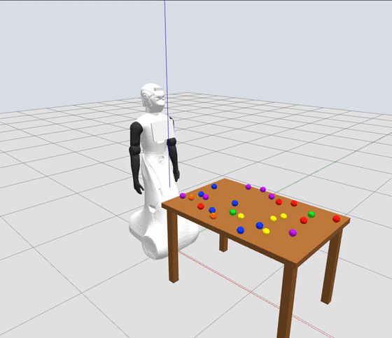

# ARI counting experiment environment

Docker simulation of **PAL Robotics ARI v2, ROS 2 Humble and Gazebo Classic 11**, with 1–100 fixed coloured balls, three calibrated RGB cameras, keyboard joint control, position-only IK, and recording/export tools for future VLA work. No VLA model, perception/counting algorithm, grasping or physical-robot connection is implemented.



The same run as video: [Gazebo view](docs/media/demo_gazebo.mp4) and [the three experiment cameras](docs/media/demo_cameras.mp4). What was checked, and how, is in [validation results](docs/validation.md).

## Quick start

You need an x86-64 Linux host with Docker Engine and the Compose plugin, your user in the `docker` group, and about 10 GB of free disk (3.2 GB image plus recordings). Host ROS is not needed; the image installs ROS and the simulator, and source revisions are pinned in `dependencies.repos`.

```bash
git clone https://github.com/aung9htet/ARI_Counting.git
cd ARI_Counting
echo ROS_LOCALHOST_ONLY=1 > .env     # recommended, see Networking below
scripts/ari build                    # once

# Terminal 1: simulator without a window, software-rendered cameras
ARI_HEADLESS=1 scripts/ari launch ball_count:=25 seed:=42 gui:=false

# Terminal 2: wait for the simulator, then move both arms and write a video
scripts/ari run ros2 run ari_counting_tools check
scripts/ari run python3 /workspace/examples/demo_motion.py
```

`check` prints `PASS: clock, joint states, controllers, planning scene and three calibrated cameras` once everything is up, about 15 s after launch. The demo is described under [See the robot move](#see-the-robot-move). Stop the simulator with Ctrl+C in terminal 1, or with `scripts/ari stop` from any terminal (needed when the launch is not attached to a terminal); any active recording is finalized by the gateway.

## Launch options

```bash
# Desktop GUI with the NVIDIA Container Toolkit installed:
ARI_GPU=nvidia scripts/ari launch ball_count:=25 seed:=42 arm:=right gui:=true

# Fully headless, software-rendered cameras (starts Xvfb inside the container):
ARI_HEADLESS=1 scripts/ari launch ball_count:=25 seed:=42 gui:=false
```

The helper uses your UID/GID and creates `recordings/`. GUI rendering forwards the existing `DISPLAY` and `XAUTHORITY` cookie; it does not change X-server access controls. NVIDIA rendering requires an accessible host X/Xwayland display even with `gui:=false`. For machines without a display use the software/Xvfb command above. `ARI_HEADLESS=1` should be paired with `gui:=false`.

On the development laptop NVIDIA rendering runs in real time and software rendering at roughly half speed. Motions are timed on the simulation clock, so both modes behave the same apart from the wait.

Optional settings are listed in `.env.example`; put the ones you need in `.env`. `scripts/ari` exports the current UID/GID automatically. GPU support comes from `compose.nvidia.yaml`; the default Compose configuration uses software rendering through the helper.

Launch arguments:

| Argument | Default | Meaning |
|---|---|---|
| `ball_count` | `10` | Integer 1–100 |
| `seed` | `0` | Reproducible random positions and colours |
| `arm` | `right` | Arm used by gateway requests that name none; the bundled tools always send `--arm` (default `right`) |
| `gui` | `true` | Start Gazebo client |
| `config` | installed `experiment.yaml` | Table, ball palette/radius and camera settings |
| `output_dir` | `/data` | Persistent output; `/data` maps to `recordings/` |

For custom settings, copy `src/ari_counting_sim/config/experiment.yaml`, edit it and pass `config:=/workspace/path/to/config.yaml`. A new launch creates a new scene under `recordings/scenes/<scene-id>/` with `counting.world`, `robot.urdf`, `robot.srdf`, `controllers.yaml` and `scene.json`. Change count/seed by relaunching. Stop recording before resetting simulation; each reset requires a new episode.

### Networking

The containers share the host network. By default ROS 2 (domain 42) and Gazebo bind to one of the host's LAN interfaces, which has two consequences:

- If that interface changes while the simulator runs (Wi-Fi roaming, a VPN, unplugging a dock), the launch log fills with `ddsi_udp_conn_write ... failed`, every tool reports `experiment gateway not found`, and the simulator has to be restarted.
- Another machine on the same network running this repository on the same domain shares your topics, controllers and clock.

`ROS_LOCALHOST_ONLY=1` in `.env` keeps both ROS 2 and Gazebo traffic on loopback and avoids both. Every `scripts/ari` command must use the same value, which is why it belongs in `.env`. Each process then prints one harmless `selected interface "lo" is not multicast-capable` notice. Leave it at `0` only if another machine has to reach the simulator; then give each simulator its own `ROS_DOMAIN_ID`.

## See the robot move

With the simulator running:

```bash
scripts/ari run python3 /workspace/examples/demo_motion.py
```

The right arm waves and moves its hand through three XYZ targets, then the left arm points toward the table: about 40 s of simulated motion, each step checked for collisions by the gateway like any other command. The run is recorded (a raw bag of about 2 GB), exported, and joined into one H.264 video of the front, overhead and robot cameras at `recordings/episodes/<episode-id>/export/demo.mp4`.

To only watch it in the Gazebo window, without recording:

```bash
scripts/ari run python3 /workspace/examples/demo_motion.py --no-record
```

## Two arm-control examples

Keep the simulation running and use another terminal in the repository:

```bash
# Example 1: keyboard joint jogging
scripts/ari run ros2 run ari_counting_tools joint_control --arm right

# Or five absolute targets, radians in joint 1..5 order:
scripts/ari run ros2 run ari_counting_tools joint_control \
  --arm right --positions 0.1 0.15 0.1 0.2 0.1 --duration 3

# Scripted joint trajectory with absolute waypoint times:
scripts/ari run ros2 run ari_counting_tools joint_control \
  --trajectory /workspace/examples/joint_trajectory.yaml

# Example 2: XYZ position target in metres, expressed in base_link.
# IK starts from the current posture, so raise the arm toward the target first:
scripts/ari run ros2 run ari_counting_tools joint_control \
  --arm right --positions 0.5 0.15 0.0 0.6 0.0 --duration 3
scripts/ari run ros2 run ari_counting_tools ik_control \
  --arm right --xyz 0.22 -0.26 0.87 --frame base_link
```

The joint examples above move each joint by about 6°, which is easy to miss in the Gazebo window; the demo in the previous section is the quick visual check.

The XYZ target is checked against the current state and scene; IK rejects targets outside the arm workspace or in collision. This is position-only control: orientation is free. ARI v2 has five joints per arm and cannot realize arbitrary six-dimensional poses. Because the elbow and wrist are free, IK from the arms-down posture often returns a valid but twisted arm that differs from call to call; starting near the target, as above, returned the same posture on every run.

ARI's arms are for gestures, not manipulation. Over 3,000 sampled collision-free postures the right hand stayed within x −0.77…0.33 m, y −0.74…0.12 m and z 0.70…1.66 m in `world` (mirror y for the left arm). The default table starts at x = 0.35 m, so the hand never gets over it and comes no closer than about 0.2 m to its near edge: ARI can point toward the balls but cannot touch them.

Keyboard controls: `1`–`5` select a joint, `+`/`-` jog, `[`/`]` change the step, `c` cancel and hold, `q` quit. The initial step is 0.05 rad. API values use radians; the terminal displays degrees. Ctrl+C requests cancellation.

| Joint number | Hard range (degrees) | Right local axis | Left local axis |
|---|---|---|---|
| 1 | −120 to 120 | +Z | −Z |
| 2 | 0 to 100 | +Z | +Z |
| 3 | −120 to 120 | −Z | +Z |
| 4 | 0 to 100 | +Z | −Z |
| 5 | −120 to 120 | −Z | +Z |

Axes are expressed in each joint's local frame, which is rotated relative to the robot base. Positive jogging rotates around the indicated axis by the right-hand rule. The gateway derives the actual names, soft limits and velocity limits from PAL's expanded URDF. Soft limits stay 0.05 rad inside the hard range. Joints 2 and 4 start at 0.1 rad. Each joint can be exercised separately with keyboard jogging.

For example, press `1+` to rotate joint 1 by +0.05 rad (2.86°); use `2+`, `3+`, `4+` and `5+` to exercise the remaining joints individually after each motion finishes. Press the selected joint's `-` key to reverse that step. The same keys apply to the left arm with its listed axes.

Direct trajectories use quintic interpolation, a maximum of 50% of URDF velocity limits, and collision checking of intermediate states. IK uses current measured state, MoveIt/KDL and OMPL with conservative velocity/acceleration scaling. Both modes use the same `FollowJointTrajectory` controller and command logger. Only one gateway arm motion is active at a time. Use the gateway API for experiments: publishing directly to controllers bypasses its validation, ownership and action log.

Only the arms are commanded. The base is anchored to the world, and the head is held at its start pose by a `head_controller` so that it does not sag; the gateway has no head or base command.

## Record and export

```bash
scripts/ari run ros2 run ari_counting_tools record start \
  --instruction 'Count the red balls while pointing.'

# Run either control example, then finish the episode:
scripts/ari run ros2 run ari_counting_tools record stop

# Inspect current readiness and recording path:
scripts/ari run ros2 run ari_counting_tools record status

# Substitute the episode ID printed by start/stop:
scripts/ari run ros2 run ari_counting_tools export_episode /data/episodes/EPISODE_ID
```

Recording is owned by the running gateway, so exiting the start command does not stop capture. Start waits for cameras, calibration, joint states, controllers and the planning scene. `stop` flushes the bag. The episode includes the original bag, generated world/URDF/scene, software revisions, camera settings, selected arm and optional language instruction.

Exports appear under the episode's `export/` directory:

- `overhead.mp4`, `front.mp4`, `robot.mp4` plus per-frame source and bag timestamp CSVs.
- `joint_states.csv` with measured position, velocity and effort where available.
- `observations.npz` containing 20 Hz timestamps, aligned joint values, source timestamps, per-field validity masks, camera frame indexes and action-event indexes.
- `actions.jsonl` containing requested commands, planned trajectories, controller acceptance and completion/failure events.
- `calibration.json` and `metadata.json`.

All alignment uses simulation time and selects the latest sample **at or before** each observation timestamp. Samples older than 100 ms are missing (`NaN`, index `−1`, and false masks). No future-frame alignment or fabricated measurements is used. Live observations align to the newest common camera capture time and report `query_stamp_ns` and `latency_ns`; this exposes rendering delay without mixing image and joint time steps. `*_frames.csv` is authoritative: MP4 playback has a constant frame rate and is not a timing measurement. `action_event_index` indexes `actions.jsonl`, not a fabricated control vector; future training code can select requested targets, planned actions or measured outcomes explicitly. Ground-truth counts and positions remain in `scene.json`, outside model observations.

Raw RGB bags are large: three 640×480 RGB streams at 20 FPS are approximately 55 MB per simulated second before database overhead. Export videos are much smaller; retain the original bag when source fidelity matters.

The exported MP4s use the MPEG-4 Part 2 codec (`mp4v`). VLC, mpv and OpenCV play it; browsers, GitHub and the VS Code preview do not. Convert a view to H.264 when you need to watch it there:

```bash
scripts/ari run ffmpeg -i /data/episodes/EPISODE_ID/export/front.mp4 \
  -c:v libx264 -pix_fmt yuv420p /data/episodes/EPISODE_ID/export/front_h264.mp4
```

## Python integration skeleton

```python
from ari_counting_tools.client import ExperimentClient

with ExperimentClient(arm="right") as robot:
    robot.wait_ready()
    observation = robot.get_observation()
    # observation['cameras']['robot']['image']: RGB NumPy array or None
    # observation['joint_state']: measured ROS JointState or None
    episode = robot.start_recording("Observe the coloured balls.")
    try:
        robot.command_joints([0.1, 0.15, 0.1, 0.2, 0.1], duration=3)
        # robot.move_xyz(x, y, z, frame="base_link")
        # robot.command_trajectory([{'positions': [...], 'time': 3.0}, ...])
        # robot.cancel()
    finally:
        robot.stop_recording()
```

Run `examples/vla_tools.py` for a model-free observation/recording example, `examples/demo_motion.py` for larger motions, or `examples/read_bag.py` to read original bag messages. Put your future policy between observation acquisition and explicit tool calls. See [interfaces and data semantics](docs/interfaces.md).

## Development and checks

```bash
# Rebuild mounted source into a host-owned ROS overlay:
scripts/ari rebuild
# Subsequent helper commands source /workspace/install automatically.

# ROS-independent tests, inside the container:
scripts/ari run python3 -m pytest -q /workspace/tests
# or on the host (Python, PyYAML, NumPy and pytest):
PYTHONPATH=src/ari_counting_sim:src/ari_counting_tools PYTEST_DISABLE_PLUGIN_AUTOLOAD=1 \
  python3 -m pytest -q tests

# Against a running simulator:
scripts/ari run ros2 run ari_counting_tools check
scripts/ari run ros2 run ari_counting_tools check --motion --record
scripts/ari run python3 /workspace/tests/integration_controls.py

# A shell in the container, and a full image rebuild that ignores the cache:
scripts/ari shell
scripts/ari build --no-cache --pull
```

A Docker rebuild also updates the baked-in packages. The host overlay takes precedence when present: after changing or pulling source, run both `scripts/ari rebuild` and `scripts/ari build`, or delete `build/`, `install/` and `log/` to use the image-installed code. [Validation results](docs/validation.md) distinguish completed checks from remaining limitations.

## Troubleshooting and upstream sources

- `experiment gateway not found` or `simulation did not become ready`: the launch is not running, the terminals disagree on `ROS_DOMAIN_ID` or `ROS_LOCALHOST_ONLY`, or the host network changed under a running simulator (see [Networking](#networking)). Restart the launch.
- GUI authorization: check host `DISPLAY` and `XAUTHORITY`, and pass them through the environment. Use headless software rendering if no X server is available.
- GPU: install NVIDIA Container Toolkit and verify Docker GPU access; choose `ARI_GPU=nvidia`. The laptop configuration enables PRIME rendering offload.
- Discovery: all experiment/client containers must use the same `ROS_DOMAIN_ID` (default 42), the same `ROS_LOCALHOST_ONLY` and Cyclone DDS. Only run one scene per domain and Gazebo master port.
- Stale data: `record status` reports camera and joint freshness. Software rendering runs below real time; alignment remains in simulation time.
- Invalid motion: increase duration for speed-limit failures, choose another target for collision/IK failures, and cancel before retrying a timed-out command.
- A video will not play: see the H.264 note under [Record and export](#record-and-export).
- Gazebo's optional audio and octomap warnings do not prevent this RGB-only experiment. No audio or depth perception pipeline is configured.
- The installed MoveIt binary may print a destructor crash on shutdown; recording finalization is checked separately. See the observed limitation in [validation results](docs/validation.md).

PAL's [ROS 2 ARI simulation](https://github.com/pal-robotics/ari_simulation/tree/humble-devel) and [robot description](https://github.com/pal-robotics/ari_robot/tree/humble-devel) are the reference sources. Its [SDK 23.1 Docker guide](https://docs.pal-robotics.com/ari/sdk/23.1.11/development/docker-dev.html) targets ROS 1 Noetic; this repository uses native ROS 2 instead. Gazebo Classic is the compatibility baseline for the selected public ARI controller stack. Base and caster motion are fixed for tabletop experiments; the arm geometry and joint definitions come from PAL.

Our source is Apache-2.0. Fetched PAL assets retain their upstream licenses, including the attribution/noncommercial/no-derivatives notices present in some robot-description files; do not assume every mesh/description asset is Apache-licensed.
