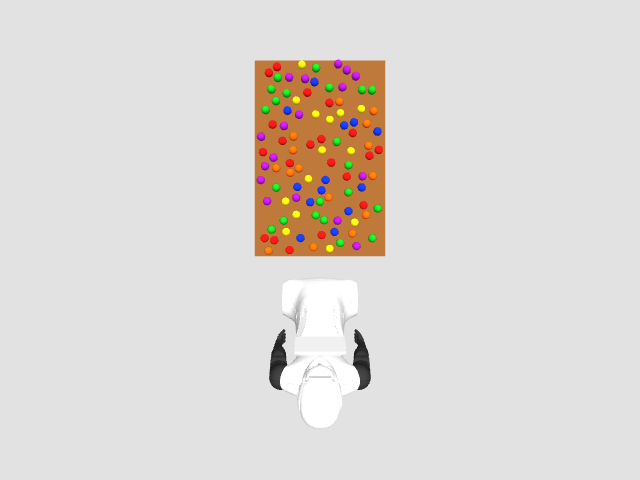
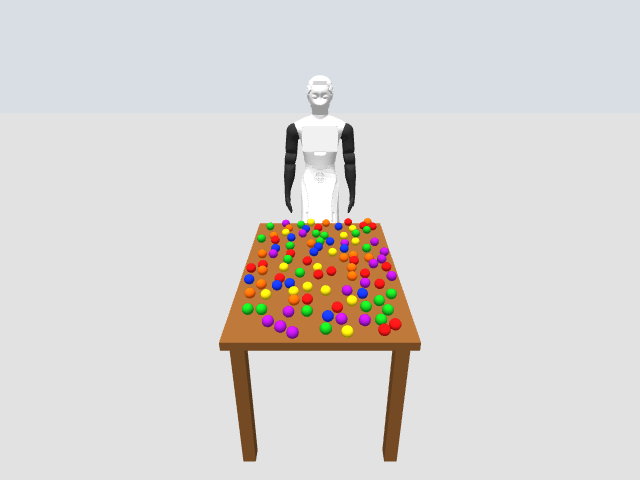
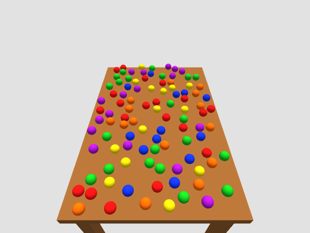

# Validation results

Validated on 9 October 2026 on the development laptop: Ubuntu 22.04,
x86-64, Docker 28, NVIDIA RTX 4060 Laptop GPU, ROS 2 Humble and Gazebo 11
inside `ari-counting:humble`. Source revisions are in `dependencies.repos`;
each recorded episode includes the revisions, source checksum and scene snapshots.

| Check | Result |
|---|---|
| Docker image build with public PAL dependencies | Passed |
| Mounted-source development build and separate client container | Both packages built; readiness/camera check passed through `scripts/ari run` |
| Scene and trajectory unit tests | 20 passed: counts 1/25/100, seed reproducibility, boundaries, non-overlap, invalid inputs, limits, speeds, duration and causal timestamp selection |
| Headless software-rendered simulation | Passed: 25 balls, three RGB/calibration streams, advancing clock, active controllers and MoveIt scene |
| NVIDIA simulation with Gazebo GUI | Passed: 100 balls, ARI meshes, all cameras/controllers and scene readiness |
| Right-arm joints | Each of the five joints moved independently and returned; measured target tolerance checked |
| Left-arm interface | CLI five-joint target executed successfully |
| Manual keyboard | Interactive joint selection, jogging and quit tested through a container terminal |
| Reachable IK | Target derived from measured FK, requested in `world`; final position error **0.000268 m**, below the 1 cm requirement |
| Invalid and unreachable commands | Out-of-limit targets and unreachable XYZ targets rejected |
| Collision rejection | Temporary MoveIt obstacle around the arm rejected a direct trajectory without movement; obstacle removed afterward |
| Concurrency/cancellation | Second active command rejected; cancellation stopped and held the arm |
| Joint and IK recording/export | Bags finalized; videos decoded and frame counts matched timestamp sidecars; measured-state masks and causal alignment checked |
| Active-recording container shutdown | Bag finalized, recorder exit 0, metadata marked `experiment_shutdown`; exported successfully |
| Model-free integration and bag-reading examples | Passed: three RGB arrays acquired and recorded; 952 original messages read from the shutdown-test bag |

Representative retained episodes under `recordings/episodes/`:

- `bbe91462e1b443dca5639d6fd870482a`: final five-joint episode, 585 overhead/front frames, 586 robot frames, 1,464 joint samples, 586 observation rows and 49 action events.
- `771e98051ab54dca940644bb1a13caf8`: final IK/cancellation/collision run, 316 overhead frames, 315 front/robot frames, 789 joint samples, 316 observation rows and 29 action events.
- `844753d92dc64a12bd5596de3dac12f2`: software-rendered shutdown test, 40 frames per camera, 100 joint samples and 41 observation rows. Missing samples at recording boundaries remain masked.

Recordings are ignored by Git. Reproduce motion checks against a running simulator:

```bash
scripts/ari run ros2 run ari_counting_tools check --motion --record
scripts/ari run python3 /workspace/tests/integration_controls.py
scripts/ari run python3 /workspace/tests/verify_export.py /data/episodes/EPISODE_ID/export
```

## Actual camera views

These images were captured from the final 100-ball simulation, rather than rendered separately.

| Overhead | Front | Robot-mounted |
|---|---|---|
|  |  |  |

## Runtime limitations

- This validates the development laptop and bundled configurations. Other GPUs,
  custom camera poses and custom table dimensions have not been exercised.
- Software rendering runs below real time. Sensor timestamps and exported
  alignment use simulation time; live observations expose rendering latency.
- The installed Humble MoveIt binary can report a segmentation fault in its
  trajectory-execution-manager destructor during shutdown. This was observed
  after shutdown was requested; Gazebo and the gateway exited, the recorder
  flushed successfully and the container stopped. Runtime planning and control
  checks passed. The repository does not patch upstream MoveIt binaries.
- Position-only IK leaves orientation free. Tests establish one reachable target,
  rather than coverage of every ball or the entire arm workspace.
- Proprioception comes from Gazebo's exported interfaces. Missing effort/velocity
  fields remain missing; these records do not establish physical-robot dynamics.
- Force-killing the container or losing power cannot guarantee bag finalization.
  The exporter refuses episodes without a finalized bag; original data can be
  inspected/recovered separately with ROS bag tools.
